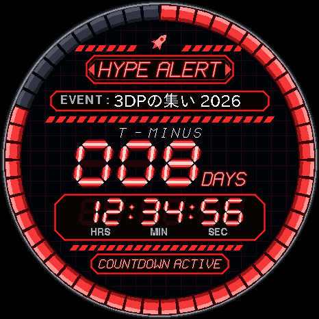
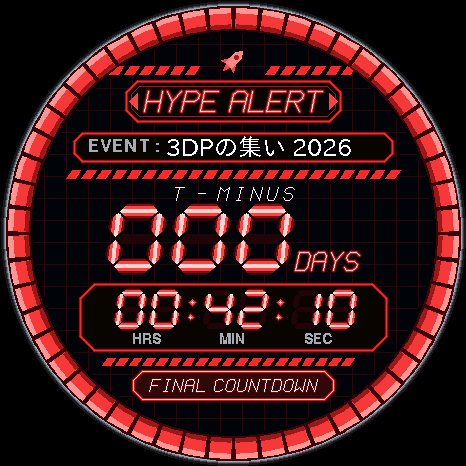
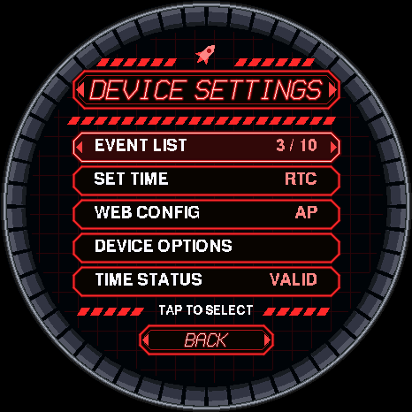
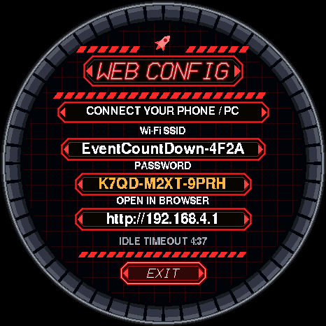

# EventCountDown

楽しみなイベントまでの残り時間を、赤黒の SF 警報装置風の画面で数える **M5StopWatch** 用ファームウェアです。

| カウントダウン | 最後の 1 時間 | 設定メニュー | Web 設定 |
|:---:|:---:|:---:|:---:|
|  |  |  |  |

<sub>画面はプレビュー用ハーネス（`tools/preview/`）で描画したもので、実機の写真ではありません。イベント名・SSID・パスワードはサンプルです。</sub>

- 最大 10 件のイベントを登録し、ボタンで切り替えて表示（日数 + HH:MM:SS の 7 セグ表示と 52 区画の進捗リング）
- イベントの登録・時刻合わせ・Wi-Fi 設定は、本体の Wi-Fi アクセスポイントにスマホ / PC から接続して Web 画面で行う
- 家庭用 Wi-Fi を登録すると NTP で自動的に時刻を補正

[wararyoLauncher](https://github.com/wararyo/M5StopWatch-wararyoLauncher) のゲストアプリとして入れることもできます
（→ [docs/LAUNCHER.md](docs/LAUNCHER.md)）。この README は単体で使う場合の手順です。

> [!WARNING]
> **実機での動作確認がまだ済んでいません**（ビルド・ユニットテスト・PC シミュレータでの描画確認のみ）。
> 詳細は [docs/DEVELOPMENT.md](docs/DEVELOPMENT.md#検証結果2026-10-24esp-idf-移行後) を参照してください。

## 必要なもの

| 種類 | 内容 |
|---|---|
| 本体 | M5StopWatch（ESP32-S3、466×466 円形 AMOLED、16 MB Flash） |
| ケーブル | データ通信できる USB-C ケーブル |
| 書き込み | Releases の bin を使う場合: Python 3 と [esptool](https://github.com/espressif/esptool)（v5 以降）<br>ソースからビルドする場合: [PlatformIO](https://platformio.org/)（VS Code 拡張または PlatformIO Core CLI。ESP-IDF 5.5 とライブラリは初回ビルド時に自動で取得される） |

> [!CAUTION]
> 書き込みは**フラッシュ全体の配置（ブートローダ・パーティション表・アプリ）を上書き**します。本体に入っていた
> ファームウェア（wararyoLauncher を含む）は消えます。Launcher と共存させたい場合は [docs/LAUNCHER.md](docs/LAUNCHER.md) の手順を使ってください。

### シリアルポート

USB で接続した M5StopWatch のシリアルポートを確認します。

| OS | 例 | 探し方 |
|---|---|---|
| Windows | `COM11` | デバイスマネージャーの「ポート (COM と LPT)」 |
| macOS | `/dev/cu.usbmodem1101` | `ls /dev/cu.usbmodem*` |
| Linux | `/dev/ttyACM0` | `ls /dev/ttyACM*`（権限がなければ `dialout` グループに追加） |

以下の例の `COM11` は、環境に合わせて読み替えてください。

## 書き込み（Releases の bin を使う）

ビルドせずに書き込めます。

1. esptool を入れます（初回のみ）。

   ```sh
   pip install esptool
   ```

2. [Releases](https://github.com/denchi-45/M5StopWatch_Countdown/releases) から使いたい版を開き、Assets の
   `EventCountDown-<版>-standalone.bin` をダウンロードします。
3. リリースノートの SHA-256 と一致するか確認します。

   ```powershell
   Get-FileHash "$HOME\Downloads\EventCountDown-v0.1.0-standalone.bin" -Algorithm SHA256   # Windows
   ```

   ```sh
   shasum -a 256 ~/Downloads/EventCountDown-v0.1.0-standalone.bin   # macOS
   sha256sum ~/Downloads/EventCountDown-v0.1.0-standalone.bin       # Linux
   ```

4. 元に戻したい場合に備えて、16 MB 全体をバックアップしておくことをおすすめします（数分かかります）。

   ```sh
   esptool --chip esp32s3 --port COM11 read-flash 0 0x1000000 backup.bin
   ```

5. アドレス `0x0` に書き込みます。終わったら本体をリセット（電源を入れ直す）してください。

   ```sh
   esptool --chip esp32s3 --port COM11 write-flash 0x0 EventCountDown-v0.1.0-standalone.bin
   ```

`standalone.bin` はブートローダ・パーティション表・アプリを 1 つにまとめたイメージです。
同じリリースの `launcher.bin` は wararyoLauncher 用なので、この手順には使いません。

## 書き込み（ソースからビルドする）

```sh
git clone https://github.com/denchi-45/M5StopWatch_Countdown.git
cd M5StopWatch_Countdown
pio run -t upload                           # ビルドして書き込む（ポートは自動検出）
pio run -t upload --upload-port COM11       # ポートを指定する場合
```

初回は ESP-IDF などのダウンロードで時間がかかります。ビルドだけなら `pio run` です。

書き込む前に 16 MB 全体をバックアップする場合は、PlatformIO に入っている esptool（4.9）を使って次のようにします。

```sh
pio pkg exec -p "platformio/tool-esptoolpy@~2.40900.0" -- esptool.py --chip esp32s3 --port COM11 read_flash 0 0x1000000 backup.bin
```

| 環境 | 用途 |
|---|---|
| `m5stopwatch`（既定） | 単体で動かすファームウェア |
| `m5stopwatch-launcher` | wararyoLauncher のゲストスロット用（[docs/LAUNCHER.md](docs/LAUNCHER.md)） |
| `native` | PC シミュレータ（[docs/DEVELOPMENT.md](docs/DEVELOPMENT.md#pc-シミュレータnative--sdl2)） |

### シリアルログ

```sh
pio device monitor -b 115200 -p COM11
```

## 初回セットアップ（スマホ / PC）

1. カウントダウン画面の中央を 1.5 秒長押し（タッチなし機種では KEY B を 1.5 秒長押し）して設定メニューを開き、
   `WEB CONFIG` を選びます。
   本体が Wi-Fi アクセスポイントを起動し、SSID（`EventCountDown-XXXX`）・パスワード・URL を画面に表示します。
2. パスワードは本体ごとに初回に生成される乱数（`XXXX-XXXX-XXXX`）です。本体の画面にだけ表示されます。
3. スマホ / PC でその SSID に接続し、画面に表示された URL（通常 `http://192.168.4.1`）を開きます。
   EVENTS / DEVICE / TIME / WI-FI の各ページで設定し、最後に EXIT SETUP。
4. 5 分間操作がないとアクセスポイントは自動で停止します（残り 30 秒で警告）。

時刻はインターネットがなくても TIME → `SYNC FROM PHONE / PC` で、接続中の端末の時計から設定できます。
家庭用 Wi-Fi を WI-FI に登録すると、接続のたびに NTP で自動補正し、接続中は 6 時間ごとに再補正します。

## 操作

| 画面 | 入力 | 動作 |
|---|---|---|
| カウントダウン | KEY A 短押し / KEY B 短押し | 前 / 次の有効イベント（循環、2 秒後に保存） |
| カウントダウン | 画面中央を 1.5 秒長押し | 設定メニュー |
| カウントダウン（タッチなし機種） | KEY B 1.5 秒長押し | 設定メニュー |
| 設定画面 | タップ | 項目選択・実行、＋/− |
| 設定画面 | A / B 短押し | 前 / 次の項目（編集中は値の減 / 増） |
| 設定画面 | B 1.5 秒長押し | 開く・実行・編集開始 / 編集値の確定 |
| 設定画面 | A 1.5 秒長押し | 戻る（未保存は破棄） / 編集値の取り消し |

減光中の最初の短押し・タップは画面を起こすだけで、操作としては扱いません。
Launcher に入れた場合の追加の操作（Launcher への戻り方）は [docs/LAUNCHER.md](docs/LAUNCHER.md#launcher-への戻り方) にあります。

## 既知の制限

- 表示・イベントのタイムゾーンは `Asia/Tokyo` と `UTC` のみ。
- 対応機種は M5StopWatch のみ（長方形画面の配置も持っているが、ESP32 機種は依存ライブラリの都合でビルドできない）。

その他の設計上の注意、ソース構成、PC シミュレータ、テストの実行方法は [docs/DEVELOPMENT.md](docs/DEVELOPMENT.md) にあります。

## ライセンス

[MIT License](LICENSE)

依存ライブラリ（M5Unified / M5GFX / ArduinoJson / ESP-IDF、Launcher 版では M5StopWatch-MultiFirm）はそれぞれのライセンスに従います。
`tools/upload_guard.py` は M5StopWatch-MultiFirm の配布物のコピーです。
